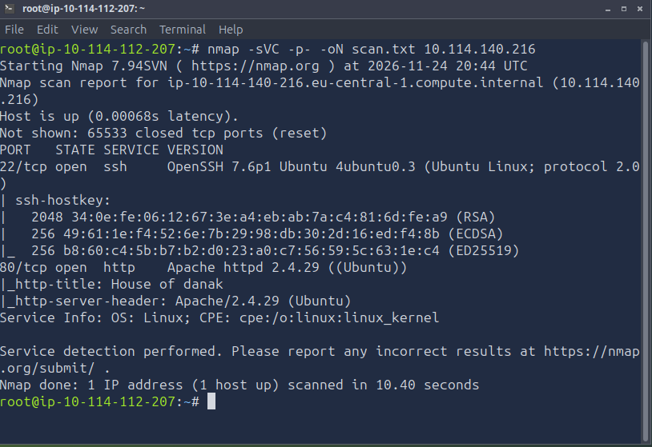
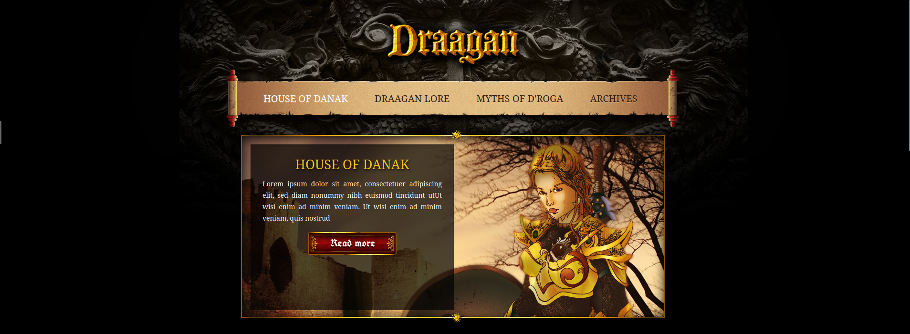
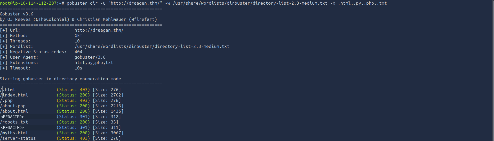
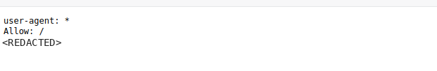
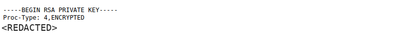
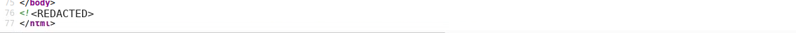
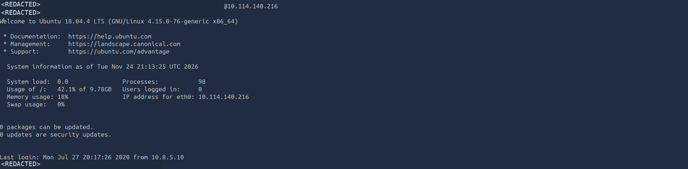
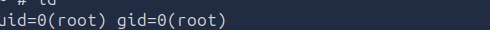

# Draagan | Penetration Testing Assessment

**Assessment date:** 24 November 2026 (UTC)  
**Environment:** Authorized training lab  
**Target:** `draagan.thm` / `10.114.140.216`  
**Overall risk:** Critical (qualitative, combined impact)  
**Release:** Public portfolio edition; secrets, flags and solution-specific identifiers redacted.

## Executive summary
I demonstrated a chain of credential exposure and excessive container-management permissions that enabled authenticated access to the Linux host and subsequent access to protected host files. An encrypted RSA private key was available through the web application. I recovered its weak passphrase offline and authenticated over SSH as the user `<REDACTED>`. I subsequently demonstrated the ability to manage privileged LXD containers and access the host filesystem. I did not test production systems.

## Scope and methodology
I assessed one lab host, its exposed TCP services, web content, authentication and local privilege boundaries. My workflow comprised network discovery, web enumeration, credential exposure validation, authenticated access and privilege-boundary validation. This was a point-in-time assessment, not an exhaustive audit or a formal compliance certification. I did not document UDP scanning, denial-of-service testing, persistence testing or cleanup.

## Technical observations
- I used Nmap to identify TCP/22 (OpenSSH 7.6p1 Ubuntu 4ubuntu0.3) and TCP/80 (Apache httpd 2.4.29 Ubuntu); 65,533 TCP ports were reported closed.
- The web application was branded Draagan; I configured a local hostname mapping. The SSH banner later identified Ubuntu 18.04.4 LTS and kernel 4.15.0-76-generic.
- My Gobuster scan returned successful responses for index.html, about.php, about.html, robots.txt and myths.html; `<REDACTED>` and `<REDACTED>` returned redirects. server-status returned 403. A redirect alone does not establish public directory listing.
- robots.txt mentioned `<REDACTED>`. An encrypted RSA private key was accessible via the web application. A source-code comment mentioned `<REDACTED>`, later confirmed as a valid SSH account by successful authentication.
- I recovered the key passphrase offline using John the Ripper and authenticated successfully with SSH. The recovered secret is intentionally excluded.
- I observed LXD group membership, but did not capture the original membership output. My screenshots demonstrate privileged container creation and host filesystem access. I read a protected host file from the container; I did not establish a direct host-root shell.

## Findings and remediation
| ID | Finding | Severity (qualitative) |
|---|---|---|
| PT-001 | Publicly exposed private key | High |
| PT-002 | Weak private-key passphrase | High |
| PT-003 | Excessive LXD management privileges | High |
| PT-004 | Account-name disclosure in HTML | Low |
| PT-005 | Service-version disclosure | Informational |
| PT-006 | Web path disclosure | Informational |

### PT-001 - Publicly exposed private key
**Evidence:** My browser displayed an encrypted RSA private key without an apparent authentication challenge. Subsequent SSH access supports its validity. **Impact:** Credential material can be copied and attacked offline. **Remediation:** Revoke and rotate the affected key, remove private keys from web-accessible paths, restrict deployment artifacts, audit access logs and implement secret scanning.

### PT-002 - Weak private-key passphrase
**Evidence:** I documented successful offline passphrase recovery and subsequent SSH login. **Impact:** Encryption did not provide effective protection against dictionary guessing. **Remediation:** Replace the affected key, use strong unique passphrases and modern key protection, and consider hardware-backed credentials. Treat this as a contributing control failure, not an independent compromise count.

### PT-003 - Excessive LXD management privileges
**Evidence:** Using an authenticated non-root account, I demonstrated privileged container management and read access to a protected host file. **Impact:** The host privilege boundary was effectively defeated for the demonstrated filesystem access; broader impact is possible but was not tested. **Remediation:** Restrict LXD administration to trusted administrators, review group membership and API access, enforce least privilege and monitor privileged containers and host filesystem mounts.

### PT-004 - Account-name disclosure in HTML
**Evidence:** A source comment addressed `<REDACTED>`; SSH authentication later confirmed the account. **Impact:** Reduced uncertainty during account discovery. **Remediation:** Remove unnecessary internal comments and identifiers from public builds; do not rely on username secrecy as an authentication control.

### PT-005 - Service-version disclosure
**Evidence:** Nmap and HTTP banner exposed service versions. **Impact:** Technology fingerprinting. No version-specific vulnerability or patch status was verified. **Remediation:** Verify supported package versions and patch status, minimize unnecessary banner details.

### PT-006 - Web path disclosure
**Evidence:** Content discovery and robots.txt exposed paths of interest. **Impact:** Improved visibility into application structure; path discovery alone is not a vulnerability. **Remediation:** Enforce authorization on sensitive resources and avoid relying on obscurity or robots.txt for access control.

## Conclusion and retest priorities
Prioritize revoking exposed credentials and removing unnecessary LXD privileges. Retest anonymous access to sensitive files, verify the old SSH key is rejected, and confirm ordinary accounts cannot administer privileged containers or access protected host files. The combined risk is rated Critical because the observed chain reached protected host data; no numeric CVSS score is asserted. I have not verified cleanup or remediation.

## Evidence and limitations
Selected screenshots are included below and in `evidence/`. I replaced sensitive values with `<REDACTED>` and cropped unnecessary material. The remaining methodology contains solution hints. Original private key material, recovered passphrase, hashes and flag values are not included. Account names and sensitive discovery paths are redacted. I based this report on my notes and screenshots; no independent live retest was performed. The target is a gaming-themed web application; a dedicated game-server service was not demonstrated. Publication permission under the lab platform's rules should be verified before uploading.

## References I consulted
- https://github.com/saghul/lxd-alpine-builder
- https://hacktricks.wiki/en/linux-hardening/user-information/interesting-groups-linux-pe/lxd-privilege-escalation.html

## Evidence gallery

### Network Scan

### Web Application

### Content Discovery

### Robots

### Key Header

### Source Comment

### Ssh Session

### Privilege Evidence

